

# Hola, soy Erick 👋

**`Full-Stack Developer · Agentes de IA · UX y valor real · Ecuador`**

> *"Deja que todo te suceda: belleza y terror. Sigue adelante. Ningún sentimiento es definitivo."*
> — Rainer Maria Rilke

Construyo software que termina usándose de verdad, no prototipos que se quedan en la carpeta. 
Estudiante de Ingeniería de Software en la Universidad de Guayaquil · apasionado por el arte, el cine y la naturaleza.

---

## ⭐ Proyecto principal

<a href="https://alata-ec.com">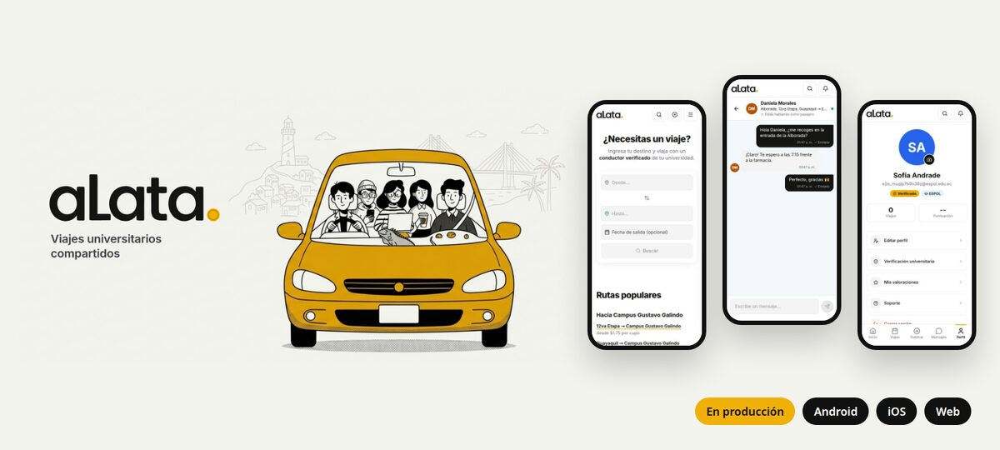</a>

### aLata — carpooling universitario en Guayaquil 🦎

App que convierte los viajes compartidos que antes se coordinaban en grupos de WhatsApp en un servicio formal y seguro: **solo universitarios verificados**, rutas hacia cada campus, chat en tiempo real entre conductor y pasajero, reservas y ganancias para el conductor. Hecha en equipo y **en producción en todos los canales**: Android, iOS y web.

`React Native` `Expo` `TypeScript` `Node.js` `Express` `PostgreSQL` `Redis` `Socket.io` `React` `Vite`

 

## 🤖 Doxi · AI Bots

<table>
<tr>
<td width="55%"><a href="https://ai-bots.us">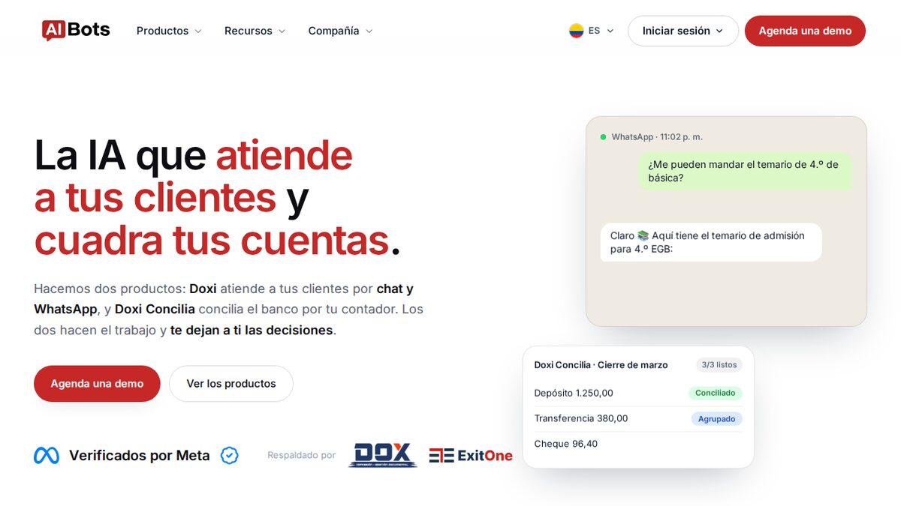</a></td>
<td width="45%">

**Agentes de IA que atienden a los clientes de un negocio** por chat web y WhatsApp: responden dudas, agendan citas y venden, con *tool-use* real sobre Claude y sin inventar datos.

Incluye el [widget de chat embebible](https://ai-bots.us) (texto, voz e imágenes en una sola línea de código) y el panel con bandeja de conversaciones, agenda y tienda.

`Express` `PostgreSQL` `Redis` `Anthropic API` `Stripe` `React`

</td>
</tr>
</table>

 

## 💼 Producción y clientes

<table>
<tr>
<td width="50%" valign="top">
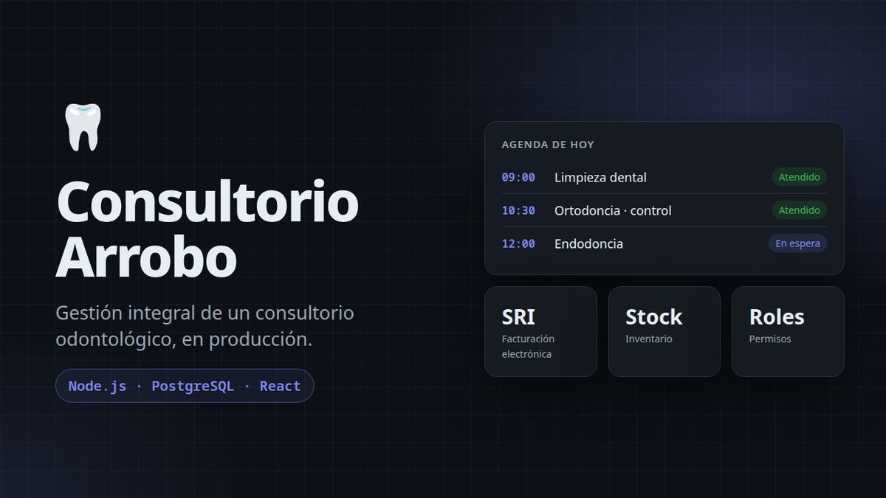

**Consultorio Arrobo** 
Sistema de gestión odontológica en producción: citas, historia clínica, facturación electrónica SRI, inventario, asistencia biométrica y permisos por rol. 
`Node.js` `Express` `PostgreSQL` `React`
</td>
<td width="50%" valign="top">
<a href="https://maqmine.com">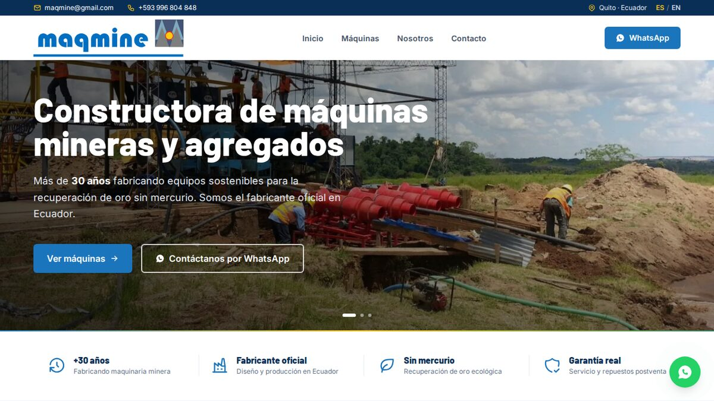</a>

**[Maqmine](https://maqmine.com)** 
Sitio y catálogo para fabricante de maquinaria minera y de agregados en Quito, con arquitectura data-driven y multi-idioma. 
`React` `TypeScript` `Vite` `Tailwind`
</td>
</tr>
<tr>
<td width="50%" valign="top">
<a href="https://exitone.us">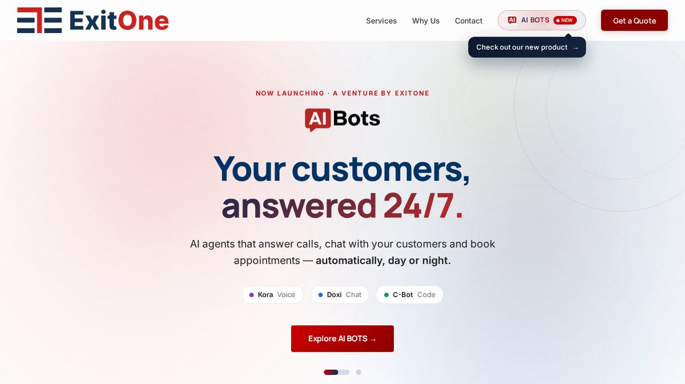</a>

**[ExitOne](https://exitone.us)** 
Insumos de impresión para negocios en EE. UU. 
`React` `Vite` `Tailwind`
</td>
<td width="50%" valign="top">
<a href="https://dox-ec.com">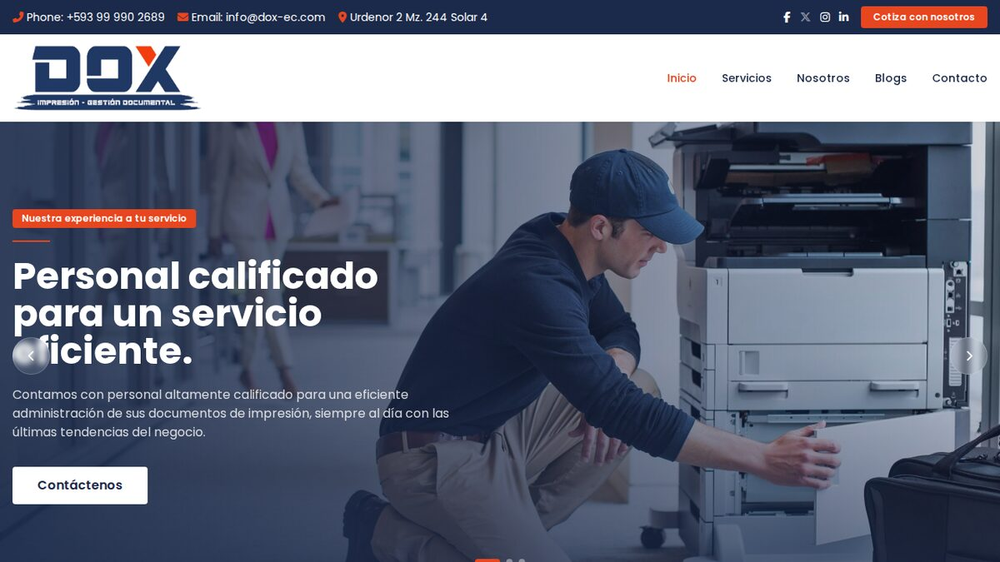</a>

**[DOX](https://dox-ec.com)** 
Impresión y gestión documental en Ecuador. 
`React` `Vite`
</td>
</tr>
</table>

## 🧠 IA aplicada

<table>
<tr>
<td width="50%" valign="top">
<a href="https://brokeate-web.vercel.app">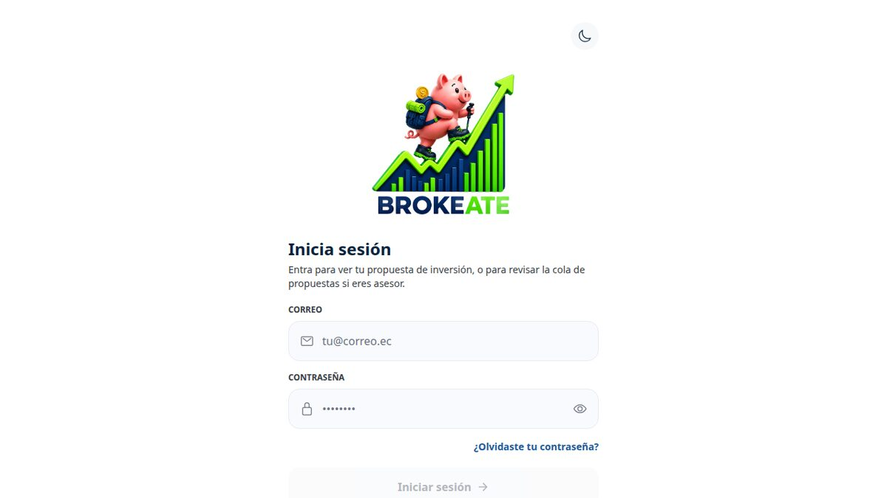</a>

**[Brokeate](https://brokeate-web.vercel.app)** 🏆 
Robo-advisor con asesor humano en el lazo: el perfil de riesgo se calcula en la base de datos y el agente explica los números, nunca los inventa. **Ganador del hackathon ESPOL/FIEC.** 
`LangGraph` `FastAPI` `Supabase` `Gemini / GPT / Claude`
</td>
<td width="50%" valign="top">
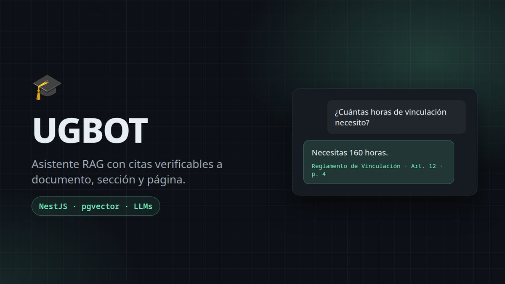

**UGBOT** 
Asistente RAG que responde solo con documentación oficial de la universidad, con citas verificables a nivel de documento, sección y página. 
`NestJS` `PostgreSQL` `pgvector` `LLMs`
</td>
</tr>
</table>

## 📰 CMS editoriales

<table>
<tr>
<td width="50%" valign="top">
<a href="https://vozurbana-umber.vercel.app">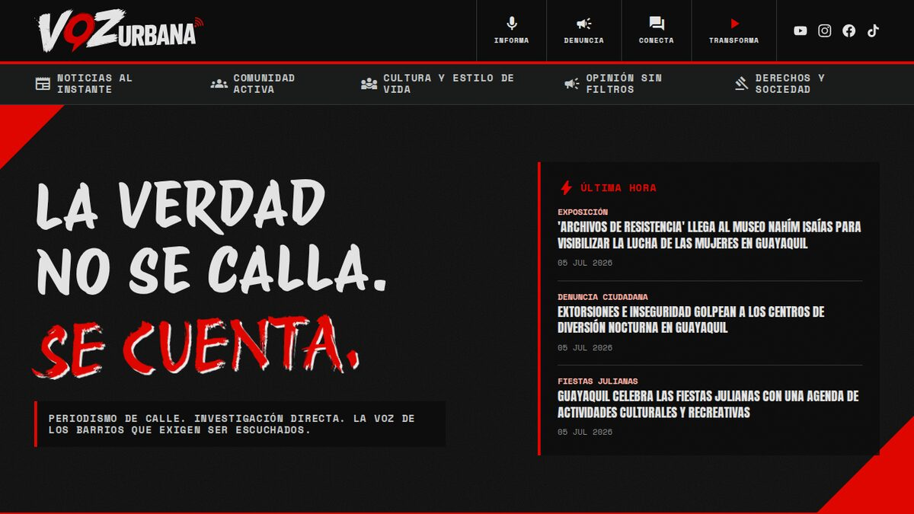</a>

**[Voz Urbana](https://vozurbana-umber.vercel.app)** 
CMS *brutalist* para un medio digital; las notas se publican subiendo Markdown. 
`React` `Vite` `Tailwind`
</td>
<td width="50%" valign="top">
<a href="https://trendmix.vercel.app">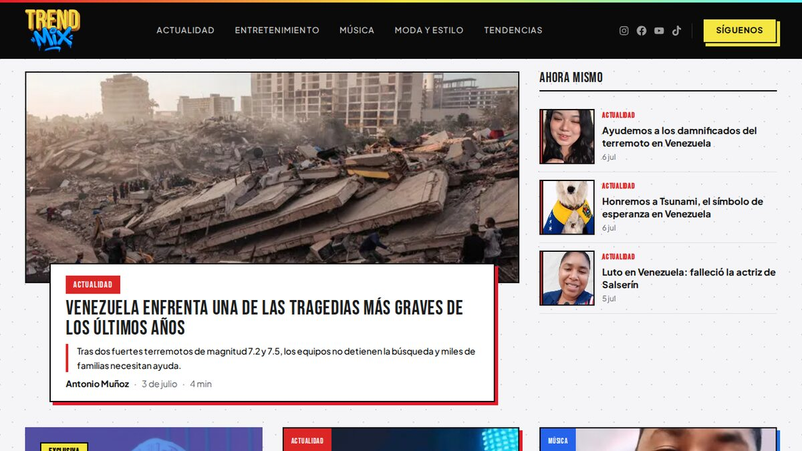</a>

**[TrendMix](https://trendmix.vercel.app)** 
CMS de entretenimiento con soporte de fotos y video. 
`React` `Vite` `Cloudinary`
</td>
</tr>
<tr>
<td width="50%" valign="top">
<a href="https://fanzine-beta.vercel.app">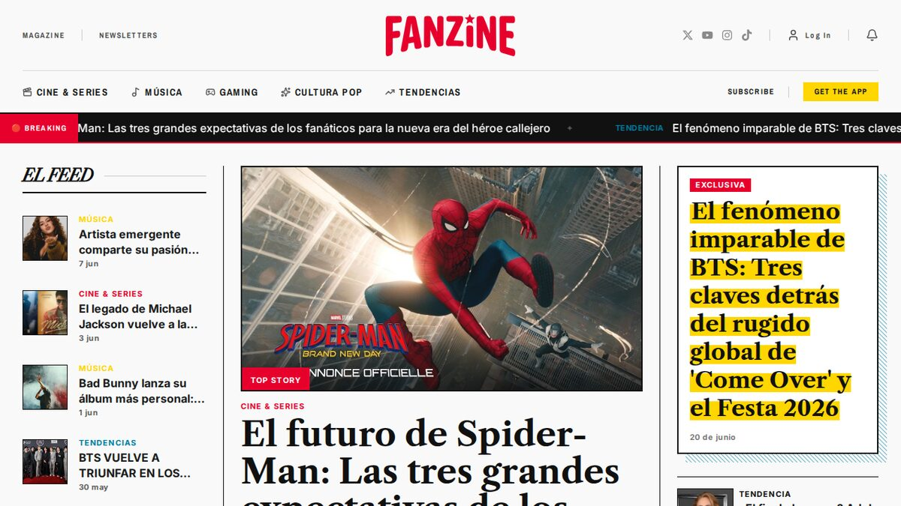</a>

**[Fanzine](https://fanzine-beta.vercel.app)** 
Revista de cultura pop y notas periodísticas, proyecto universitario. 
`React` `Vite`
</td>
<td width="50%" valign="top">
<a href="https://pequemundodigital.netlify.app">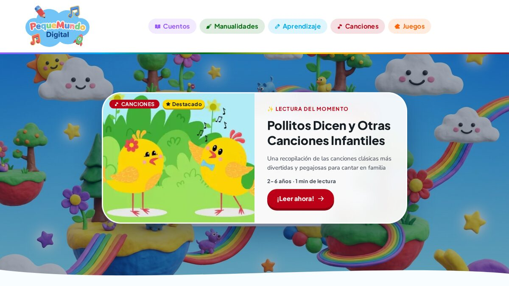</a>

**[Pequeño Mundo Digital](https://pequemundodigital.netlify.app)** 
Cuentos, canciones y juegos para niños, sobre el mismo motor de CMS. 
`React` `Vite`
</td>
</tr>
</table>

## 🎓 Académico y otros

<table>
<tr>
<td width="33%" valign="top">
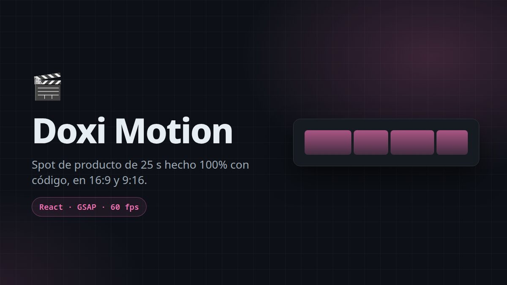

**Doxi Motion** 
Spot de producto de 25 s hecho 100 % con código. 
`React` `GSAP`
</td>
<td width="33%" valign="top">
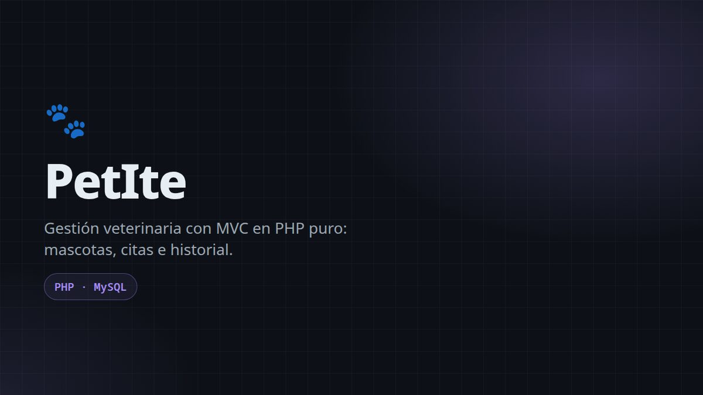

**PetIte** 
Gestión veterinaria, MVC en PHP puro. 
`PHP` `MySQL`
</td>
<td width="33%" valign="top">
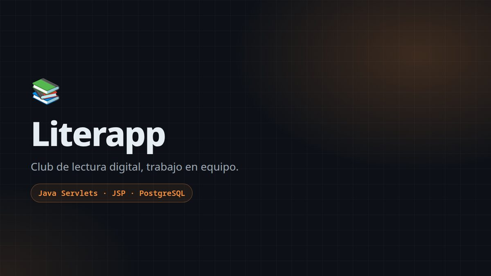

**Literapp** 
Club de lectura digital, trabajo en equipo. 
`Java Servlets` `JSP` `PostgreSQL`
</td>
</tr>
<tr>
<td width="33%" valign="top">
<a href="https://github.com/erigsml/claude-kit">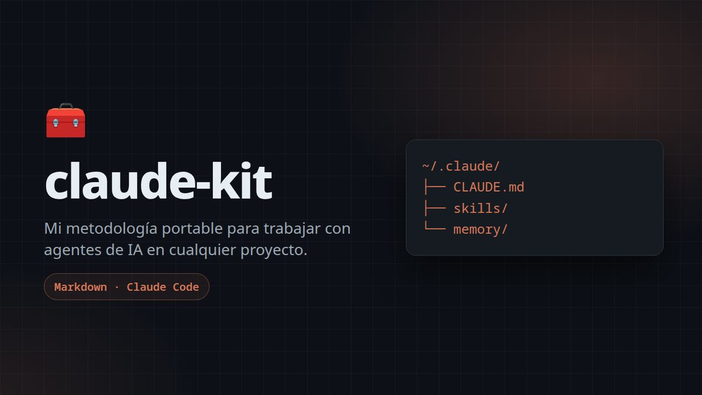</a>

**[claude-kit](https://github.com/erigsml/claude-kit)** 
Mi metodología portable para trabajar con agentes de IA. 
`Markdown` `Claude Code`
</td>
<td width="33%" valign="top">

**[Compustore](https://github.com/erigsml/COMPUSTORE)** 
Landing para tienda de tecnología. 
`HTML` `CSS` `JS`

**CV Interactivo** 
Currículum web con exportación a PDF. 
`HTML` `JS`
</td>
<td width="33%"></td>
</tr>
</table>

---

## 🛠️ Stack

**Backend** 

**Frontend & Mobile** 

**Datos, deploy & herramientas** 

**IA & automatización** 

---

*Siempre aprendiendo. tqm alocasias <3* 🌱

*A quiet life.*

